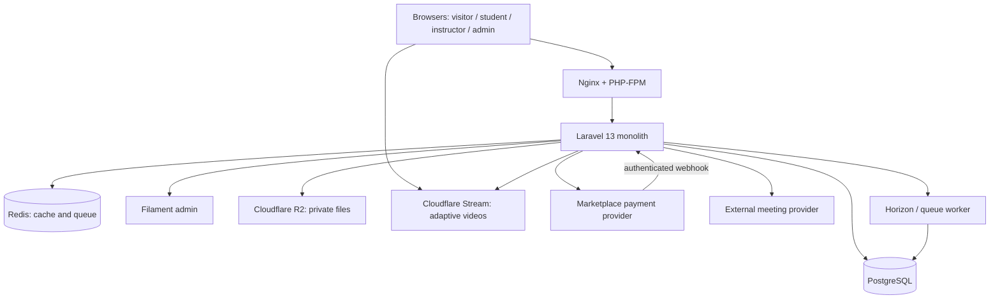

# 03 — Technical Architecture

## Architecture decision

**Modular monolith**, one deployable Laravel application and one primary PostgreSQL database. Vue 3 + TypeScript + Inertia 3 for public/learner/instructor UI, Filament 5 for back-office admin. No Node-based API server or microservices in V1.



## Modules and ownership

| Module | Responsibility | Primary owner |
|---|---|---|
| Identity | Accounts, authentication, role and profile | A |
| Catalog | Categories, published courses, search, wishlist | A |
| Instructor | Applications, onboarding, moderation, course authoring | B |
| Learning | Lessons, protected media, enrollment, progress, live class | B |
| Assessment | Questions, attempts, grade/evidence snapshots | B |
| Certification | Eligibility, immutable issuance and verification | B |
| Commerce | Cart, pricing, orders, checkout, payment states | A |
| Finance | Commission ledger, settlement, refund and payout reconciliation | A |
| Administration | Filament operations and audit views | Joint |

## Code layout (recommended, adapt to existing repo)

```text
app/
  Domain/{Identity,Instructor,Catalog,Learning,Assessment,Certification,Commerce,Finance}/
  Integrations/{Payments,Media,Meetings}/
  Http/{Controllers,Requests,Middleware}/
  Policies/ Jobs/ Filament/
resources/js/
  pages/{marketplace,student,learn,instructor,checkout}/
  components/{ui,course,learning,commerce}/
  layouts/ composables/ types/
tests/{Feature,Unit,Browser}/
docs/
```

## Conventions

- Business mutations handled by explicit action/service classes with a DB transaction when multi-row consistency matters.
- Controller: authorize → validate request → call action → return response. Never perform money logic in Vue.
- Eloquent models represent persistence; avoid cross-module service calls in model events that hide side effects.
- Queue notifications, certificate PDF generation, media processing status and reconciliation; publish events after commit.
- For operations that can be retried, store an idempotency key or unique business constraint.
- Process providers through interfaces/adapters, e.g. `PaymentGatewayInterface`; implementation only when verified against provider docs.
- Keep Laravel session auth for Inertia; APIs require explicit auth policy. Webhooks use provider verification, no CSRF exemption beyond their endpoint.
- PostgreSQL full-text search can be initial backend; add external search service only after measured need.
- Store datetimes in UTC; present Asia/Jakarta in UI; preserve original timezone/offset for scheduled live events.
- SSR for public SEO routes is a decision to benchmark; not a reason to split into Next.js without evidence.

## Key cross-module events

- `InstructorApproved`
- `CourseSubmittedForReview`, `CoursePublished`
- `PaymentVerified`, `OrderPaid`, `OrderRefunded`
- `EnrollmentActivated`, `LessonCompleted`, `QuizPassed`
- `CertificateIssued`
- `SettlementRecorded`, `PayoutStatusUpdated`

Use domain events **only where they improve clarity**; do not build a general-purpose event bus framework.

## Media access

Upload videos directly to streaming provider; persist provider UID/status, validate ownership and video-readiness via trusted callback/API. Student requests playback only after an authorization check (`active enrollment` or explicitly public preview) and receives a short-lived signed token. Serve document assets from private R2 with expiring authorized URLs.

## Infrastructure baseline

4 vCPU / 8 GiB / ~100–160 GB NVMe application VPS as an initial **testable** profile with media offloaded, plus PostgreSQL, Redis, queue worker and offsite backup. 100–500 **accounts** does not imply support for 500 concurrent quiz takers. Perform load testing first; consult `13_INFRA_AND_RAB_NOTES.md`.
