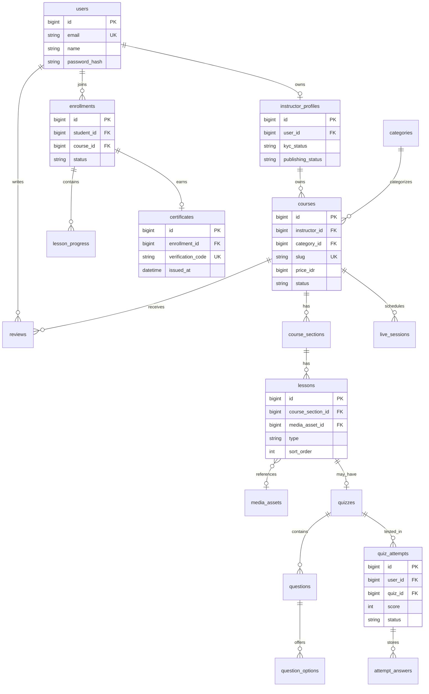
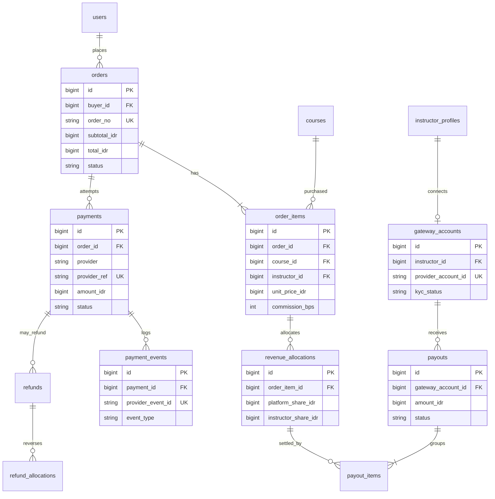

# 04 — PostgreSQL Data Model and ERD

All table names shown are planned, not claimed to exist. Use `BIGINT` surrogate PKs unless an existing repository uses UUIDs consistently. Dates in UTC (`timestamptz` for source timestamps); monetary IDR fields are integer `BIGINT`; commission percent represented as `INTEGER basis_points` (10,000 bps = 100%).

## Identity and learning

Tables: `users`, `roles`, `model_has_roles` (if using permission package), `instructor_profiles`, `categories`, `courses`, `course_sections`, `lessons`, `media_assets`, `enrollments`, `lesson_progress`, `quizzes`, `questions`, `question_options`, `quiz_attempts`, `attempt_answers`, `certificates`, `live_sessions`, `reviews`, `wishlists`, `course_moderation_events`.

### Critical constraints

- `users.email` UNIQUE (normalize as appropriate).
- `instructor_profiles.user_id` UNIQUE.
- `courses.slug` UNIQUE; `(instructor_id, status)` index.
- `enrollments(student_id, course_id)` UNIQUE; never duplicate on retry.
- `lesson_progress(enrollment_id, lesson_id)` UNIQUE; validate lesson belongs to same course as enrollment.
- `certificates.enrollment_id` UNIQUE if exactly one certificate per completed course; `verification_code` UNIQUE.
- `reviews(user_id, course_id)` UNIQUE.
- `question_options.question_id` FK; correct answers **never delivered** in quiz payload before submission.
- Use checks (e.g. price >= 0, score between 0 and 100, commission bps between 0 and 10,000), explicit FKs and delete policies.
- Historical student progress and finance evidence require soft delete/archiving strategy rather than uncontrolled cascades.

## Commerce, commissions and settlements

Other finance tables: `commission_rules`, `payment_events`, `settlement_events`, `provider_reconciliation_runs`, `audit_logs`; merchant verification details should remain with provider whenever possible to minimize sensitive data retained locally.

### Finance invariants

- On each order item, store instructor ID, course title/price snapshot, gross price, discount (if later), commission bps, fixed fee policy snapshot and currency.
- `platform_share + instructor_share + allocated_fees = gross_paid` only when fee allocation policy makes this equation correct; define exact ledger model and never guess fee inclusions. Accounting adjustments and refunds should be append-only entries, not silent edits to history.
- `payment_events(provider, provider_event_id)` UNIQUE when provider supplies an event ID; otherwise construct stable idempotency key from verified event fields.
- `payout_items(payout_id, revenue_allocation_id)` must prevent the same payable allocation from being paid twice; partial payout/adjustments require explicit records.
- Use row-level locks and transactions for state transitions; webhook may race with redirect, polling and retries.

## Migration ordering

Identity → instructor/category/course → lesson/media → enrollment/progress → assessment → certification/live/reviews → orders/items → payments/events → allocations → payouts/refunds/audit. Seed only anonymous, clearly synthetic content.
